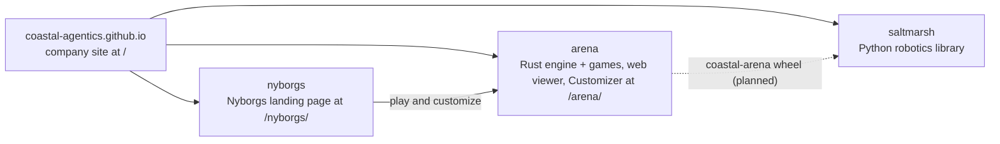

# coastal-agentics.github.io

The public website for **Coastal Agentics**, a Savannah, Georgia company. The homepage designs and tests how AI agents act before they meet the world: agentic software development and behavioral design for agents.

Served by GitHub Pages at <https://coastal-agentics.github.io> from the root of the `main` branch. Review the homepage on a local server before merging. Merging is what updates the live site. This change does not alter Pages settings or DNS.

## How the repos fit

Coastal Agentics has four public repos. They all live in the [Coastal-Agentics](https://github.com/Coastal-Agentics) GitHub org, and their sites are served together under one host.



| Repo | What it is | Owner |
| --- | --- | --- |
| [coastal-agentics.github.io](https://github.com/Coastal-Agentics/coastal-agentics.github.io) | The company site, served at `/` ([site](https://coastal-agentics.github.io/)) | Soundwave (legal pages: Onslaught) |
| [nyborgs](https://github.com/Coastal-Agentics/nyborgs) | The Nyborgs landing page, served at `/nyborgs/` ([site](https://coastal-agentics.github.io/nyborgs/)) | Blitzwing |
| [arena](https://github.com/Coastal-Agentics/arena) | The Rust engine (`engine`, `engine-cli`, `engine-wasm`, and `engine-py`, the `coastal-arena` Python wheel) plus the Tank Arena and racing games, the web viewer and the Nyborg Customizer, served at `/arena/` ([site](https://coastal-agentics.github.io/arena/)) | Engine: Shockwave. Games, web viewer and Customizer: Blitzwing |
| [saltmarsh](https://github.com/Coastal-Agentics/saltmarsh) | The Python robotics library: MuJoCo simulation, datasets, behavior and evaluation, and the robot arm demo | Shockwave |

"Saltmarsh" means only the Python robotics library. The engine is the Arena engine, and it lives in `arena`. The diagram describes those repositories. This homepage does not link to them.

## What's here

| File | Purpose |
| --- | --- |
| `index.html` | The homepage: brand and tagline, warehouse concept film, what we do, TBD concept animation and Future projects, what we believe, work with us, Savannah footer |
| `style.css` | All styles. System fonts, no framework |
| `home.js` | Play and pause for the two films. Pauses off-screen. No autoplay for reduced motion, narrow screens, or Save-Data |
| `media/` | Warehouse and TBD films and their posters. See [Homepage media](#homepage-media) |
| `logo.svg` | The mark: a solid C and a triangular A that overlap, with a hairline wave knocked out of both |
| `logo-wordmark.svg` | The mark plus "Coastal Agentics" |
| `favicon.svg` | The mark without the wave, cropped for 16 to 32px browser tabs |
| `og-image.png` | 1200x630 social preview card |
| `flock.js` | Quiet background flock from an earlier homepage. Not loaded on this proof, so the approved still layout stays clear |
| `404.html` | Not-found page. Self-contained (inline CSS and SVG) because Pages serves it at any missing path |
| `.nojekyll` | Tells Pages to serve the files as-is |
| `CARD.md` | Provenance card |

## Principles

- No build step, no framework, no trackers, no external requests except outbound links.
- Relative links for this site's own pages and assets, so it also works from a subpath or a local folder. The home link on `404.html` stays root-relative (`/`), because Pages serves that file at any missing path. The homepage itself does not link to `/nyborgs/` or `/arena/`.
- Nyborgs and Arena stay in their own repositories and are not featured or linked on this homepage. The Future projects slot is empty on purpose: no named projects and no placeholder links. Saltmarsh stays described in the repo map above and is not a homepage section in this layout.
- Palette (tonal grey-blue, from the logo): C `#436A95`, A `#5F88B7`, overlap `#34557B`, page `#FFFFFF`, text `#1F3147`, footer `#34557B`.
- Social meta tags (`og:*`, `twitter:*`) use absolute URLs, because crawlers require them.

## Local preview

```sh
python3 -m http.server 8000
# open http://localhost:8000
```

GitHub Pages for this repository publishes `main` only. There is no branch-preview URL, and this work does not add one.

## Homepage media

Copied unchanged from the supplied homepage package. No audio tracks.

| File | Role | Provenance |
| --- | --- | --- |
| `media/warehouse.mp4` | Concept visualization of a warehouse aisle. Visible label: Simulation. | H.264, 1600×900, 24 fps, 12.0 s, 3,273,989 bytes. Not a demonstration of autonomous navigation. |
| `media/warehouse-poster.jpg` | Poster shown before playback and when motion is reduced. | JPEG, 1600×900, 78,015 bytes. |
| `media/tbd-stair-hop.mp4` | Concept animation of the working-name TBD robot flying to the top of a staircase. | H.264, 1280×720, 30 fps, 24.5 s. Keyframed in Blender, not a physics simulation. |
| `media/tbd-stair-hop-poster.jpg` | Poster for the TBD film. | JPEG, 1280×720. |
| `media/spot.mp4`, `media/spot-poster.jpg` | Previous Spot film (MuJoCo, pretrained SLM-Lab policy), no longer on the homepage. | Kept for reference. |

The visible credit under the TBD film is `Concept animation · working name TBD`.

## Editing

Edit `index.html` directly. Keep the copy faithful to the Coastal Agentics manifesto, and update `CARD.md` when the sources change.
